

# Ushuaia, tu destino

**Una guía web para conocer la ciudad más austral del mundo**

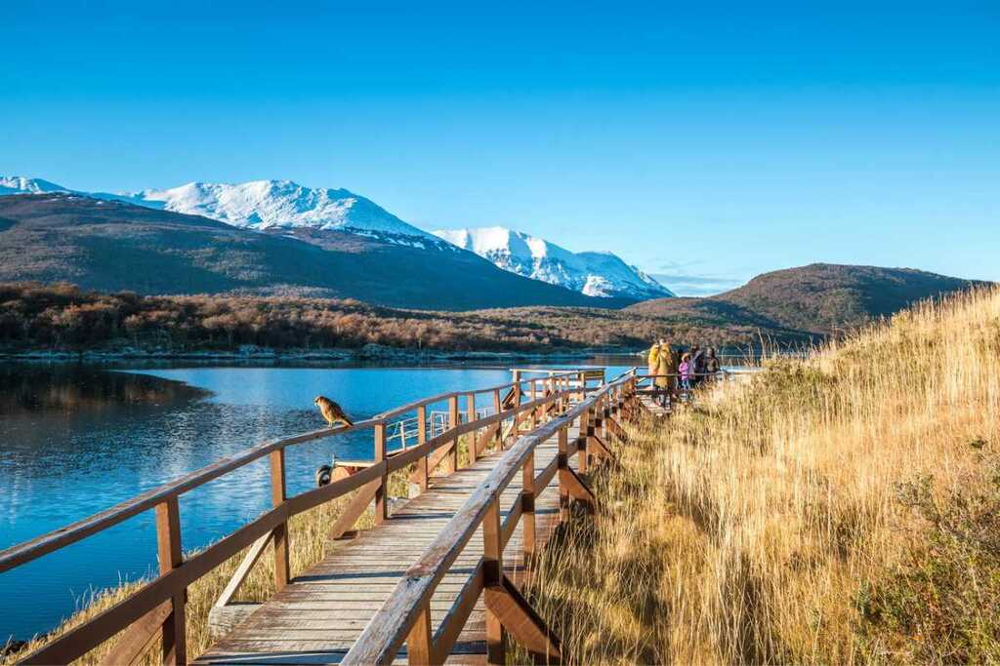

---

## Sobre el proyecto

Este sitio muestra a Ushuaia, la capital de Tierra del Fuego, ubicada muy al sur de argentina. Reúne en un solo lugar su historia, sus museos, sus paisajes y la información necesaria para planificar una visita.

Fue realizado como proyecto grupal de la materia **Lenguajes Informáticos I**.

  

---

## Qué vas a encontrar

### Inicio

La puerta de entrada al sitio. Muestra una bienvenida a la ciudad, una postal del faro Les Éclaireurs en la bahía y tres accesos rápidos a las demás secciones: historia, lugares y contacto.

  

| Historia | Lugares | Contacto |
|:---:|:---:|:---:|
| 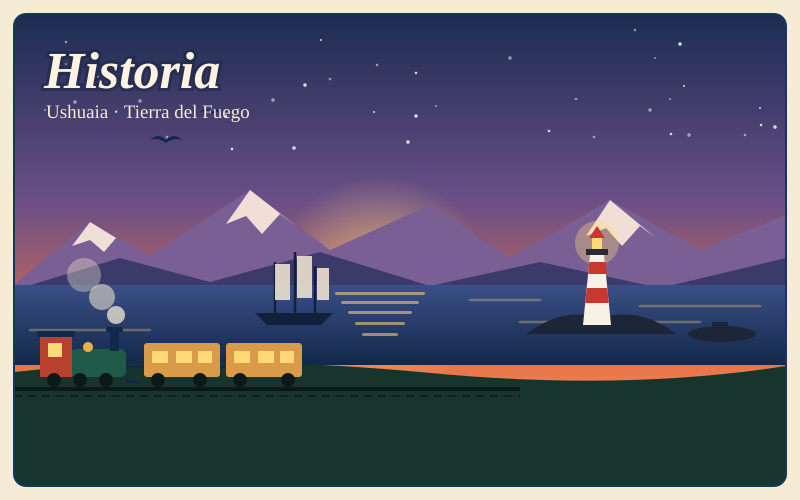 | 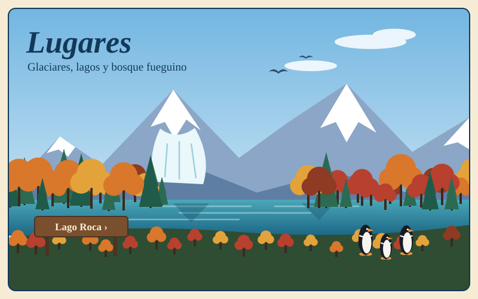 | 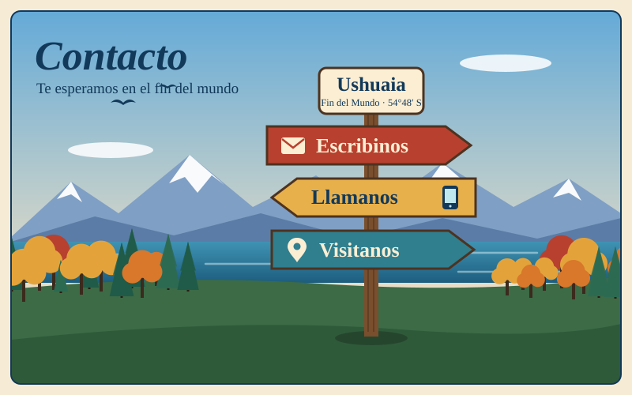 |

### Historia

Un recorrido por el pasado de la ciudad: los pueblos originarios yámanas, la misión anglicana, la fundación en 1884, los años del presidio y la llegada de nuevos habitantes gracias a la industria. Incluye una galería de fotos, una línea de tiempo y datos sobre la población actual.

| Parque Nacional | Pingüinos | Ciudad desde el mar |
|:---:|:---:|:---:|
|  | 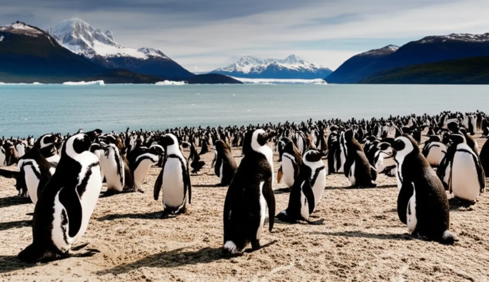 |  |

### Lugares

Los sitios imperdibles de la ciudad, divididos en dos grupos.

**Museos:** historia, cultura y vida de los antiguos pobladores.

| Museo del Fin del Mundo | Museo Marítimo y ex Presidio | Museo de la Ciudad |
|:---:|:---:|:---:|
| 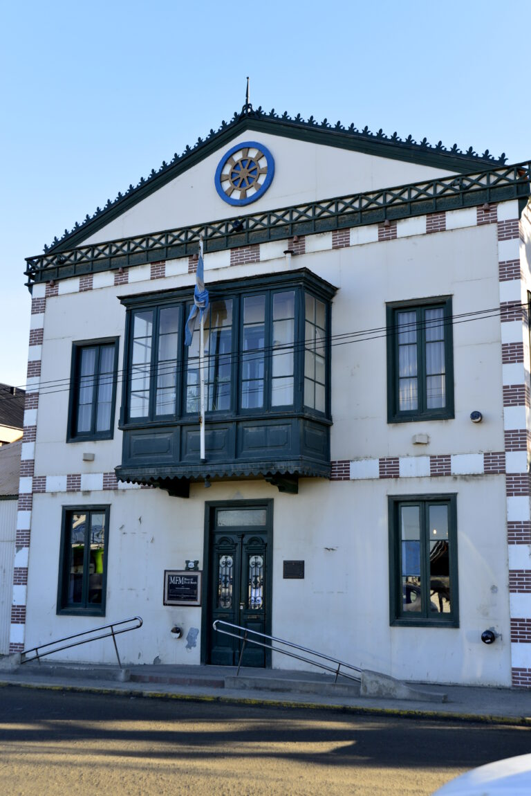 | 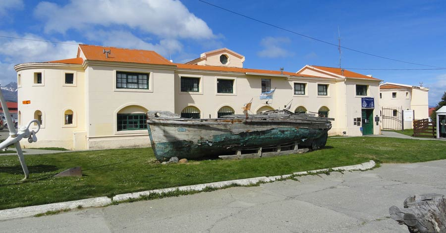 | 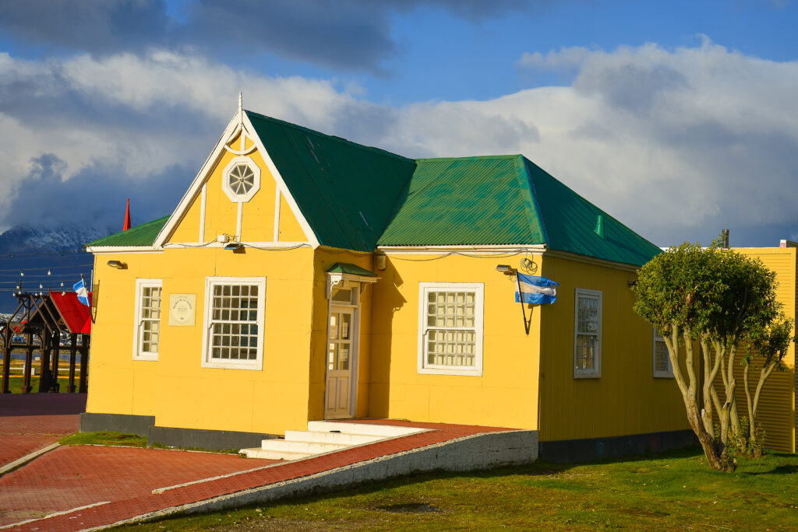 |

**Naturaleza:** bosques, lagunas y glaciares a pocos kilómetros del centro.

| Parque Nacional Tierra del Fuego | Laguna Esmeralda | Glaciar Martial |
|:---:|:---:|:---:|
| 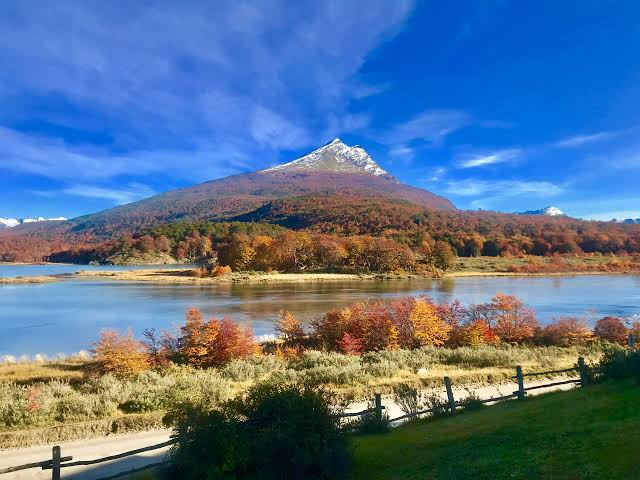 | 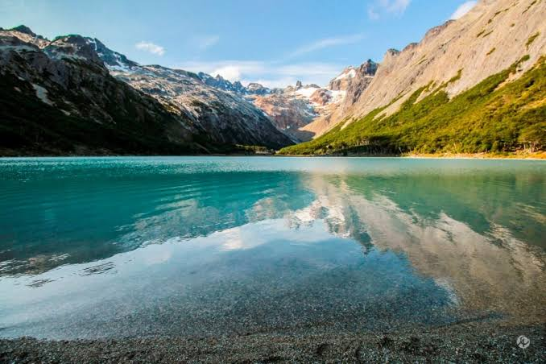 | 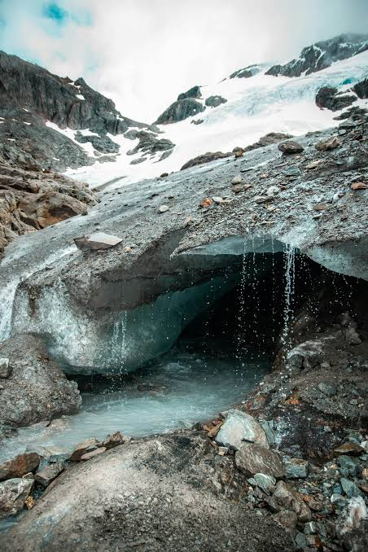 |

### Contacto

Los datos de la Oficina de Turismo de Ushuaia: dirección, teléfono, correo electrónico y su cuenta de Instagram, para consultar y organizar el viaje.

---

## Pensado para todos

El sitio se adapta a computadoras, tablets y celulares, y permite elegir entre modo claro y modo oscuro según la preferencia de cada persona. Cumpliendo con los requisitos minimos solicitados para el proyecto, diseño resposive y uso de funciones sencillas de JS

---

## Equipo

| Integrante | Parte del sitio |
|---|---|
| **Johann** | Inicio e Historia |
| **Scirica** | Lugares y Contacto |
